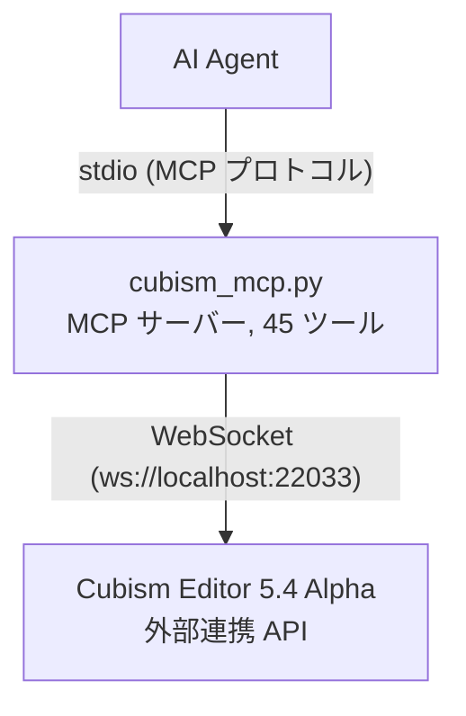

# Cubism External Edit MCP

[](https://www.live2d.com/cubism/download/editor/)
[](https://www.python.org/)
[](https://modelcontextprotocol.io/)
[](https://pypi.org/project/cubism-mcp/)

[](LICENSE)
[](https://github.com/nana7chi/CubismExternalEditMCP/stargazers)
[](https://github.com/nana7chi/CubismExternalEditMCP/commits)

[中文](../README.md) | [English](README_EN.md) | 日本語 | [한국어](README_KO.md)

Live2D Cubism Editor の外部連携 API を **MCP (Model Context Protocol)** ツールとしてラップし、AI Agent が自然言語で Cubism Editor を操作できるようにします。

> 公式リファレンス：https://creatorsforum.live2d.com/t/topic/3938

## アーキテクチャ



## 機能

- **読み書き操作** — モデルのパラメータ値読み書き、ドキュメント一覧表示、編集モード取得（Editor 4.x 以降対応）
- **モデルの完全な検査** — パラメータ構造、パーツ構造、デフォーマ構造、個別オブジェクトの詳細（5.4 Alpha が必要）
- **編集操作** — パラメータ/パーツ/デフォーマ/アートメッシュ/グルーの追加・編集・削除、自動トランザクション処理（5.4 Alpha が必要）
- **バッチ編集** — 単一トランザクションで複数操作を実行、失敗時は自動ロールバック
- **権限の段階分け** — 参照には「許可」、編集には「編集」の承認が必要
- **自動再接続** — Editor 再起動後、3 秒間隔で自動再接続
- **トークンの永続化** — 認証トークンを `~/.cubism-mcp/token.txt` にキャッシュし、再認証を回避

## 要件

| コンポーネント | バージョン |
|--------------|-----------|
| Python | ≥ 3.10 |
| Cubism Editor | 5.4 Alpha（有効期限はビルドにより異なります。使用中のバージョンの公式案内を確認してください） |
| OS | Windows / macOS |

## 使用方法

### クイックスタート

**以下のプロンプトを AI Agent にコピーして送信してください**：

> https://github.com/nana7chi/CubismExternalEditMCP/blob/master/README.md に従って、cubism-mcp をインストールして設定してください。このコンピュータに `uv` がインストールされていない場合は、先にインストールしてください。準備ができたら教えてください。


### ステップ 1：uv のインストール（初回のみ）

`uv` は軽量な Python パッケージマネージャで、本 MCP の自動インストールと実行に使用します。インストール後は Python 環境の管理が不要になります。

**macOS**（ターミナルに貼り付け）：
```bash
curl -LsSf https://astral.sh/uv/install.sh | sh
```

**Windows**（PowerShell に貼り付け）：
```powershell
powershell -ExecutionPolicy ByPass -c "irm https://astral.sh/uv/install.ps1 | iex"
```

インストール完了後、**ターミナルを再起動**し、`uv --version` でバージョンが表示されれば成功です。

> uv をインストールしたくない場合：Python（≥3.10）をローカルに用意し、`pip install -r requirements.txt` で依存パッケージをインストール後、`python cubism_mcp.py` で実行することもできます。ただし、依存関係はご自身で管理してください。

### ステップ 2：AI Agent に MCP を設定

> `ClaudeCode`、`Codex`、`Workbuddy` など各種 MCP 対応クライアントで動作します。

> 初回起動時は依存パッケージの自動ダウンロードに約 1〜2 分かかります。以降は即時起動します。

#### 方法 1：PyPI インストール（推奨）

```json
{
  "mcpServers": {
    "cubism-mcp": {
      "type": "stdio",
      "command": "uvx",
      "args": ["cubism-mcp"],
      "description": "Cubism Editor MCP",
      "env": { "NO_PROXY": "localhost,127.0.0.1" }
    }
  }
}
```

#### 中国ミラー設定

PyPI 公式が遅い場合は、中国ミラー（清華大学/Alibaba/Tencent Cloud など）を使用できます：

```json
{
  "mcpServers": {
    "cubism-mcp": {
      "type": "stdio",
      "command": "uvx",
      "args": ["--index-url", "https://pypi.tuna.tsinghua.edu.cn/simple", "cubism-mcp"],
      "description": "Cubism Editor MCP",
      "env": { "NO_PROXY": "localhost,127.0.0.1" }
    }
  }
}
```

> Alibaba `https://mirrors.aliyun.com/pypi/simple` または Tencent Cloud `https://mirrors.cloud.tencent.com/pypi/simple` に置き換えも可能です。

#### 方法 2：uvx オンライン実行（GitHub ソース）

以下のMCP設定を追加：

```json
{
  "mcpServers": {
    "cubism-mcp": {
      "type": "stdio",
      "command": "uvx",
      "args": ["--from", "git+https://github.com/nana7chi/CubismExternalEditMCP.git", "cubism-mcp"],
      "description": "Cubism Editor MCP",
      "env": { "NO_PROXY": "localhost,127.0.0.1" }
    }
  }
}
```

#### 方法 3：ローカルクローン実行

1. ソースコードをクローン（またはZIPをダウンロードして解凍）

```bash
git clone https://github.com/nana7chi/CubismExternalEditMCP.git
```

2. 以下のMCP設定を追加（`cwd` を実際のパスに変更）：

```json
{
  "mcpServers": {
    "cubism-mcp": {
      "type": "stdio",
      "command": "python",
      "args": ["cubism_mcp.py"],
      "cwd": "J:/実際のパスに変更/CubismExternalEditMCP",
      "description": "Cubism Editor MCP",
      "env": { "NO_PROXY": "localhost,127.0.0.1" }
    }
  }
}
```

### ステップ 3：Cubism Editor で外部連携を有効化

1. Cubism Editor 5.4 Alpha を起動し、モデルを開く
2. メニュー「**ファイル**」→「**外部アプリケーション連携の設定**」
3. ポートが `22033` であることを確認し、「**使用**」トグルをオンにする
4. 認証ダイアログが表示されたら `cubism-mcp` を見つけ、**「許可」と「編集」にチェックを入れて** OK をクリック

> ダイアログが表示されない場合は、Editor 右下の点滅する外部アプリアイコンを確認してください。クリックするとダイアログが開きます。


### ステップ 4：使用開始

AI Agent で自然言語を使って Editor を操作します。例：

```
「現在のモデルのパラメータ構造をリスト表示」
「パーツ階層を確認」
「眉毛パーツのラベル色を青に変更」
「パラメータ ParamsTest、ID ParamTest、範囲 0-1、デフォルト 0.5 を作成」
「ParamAngleX にキーフォームを 3 つ一括追加」
```

## 利用可能なツール

### 診断

| ツール | APIバージョン | 説明 |
|------|------------|------|
| `cubism_status` | 接続状態、登録状態、許可/編集の認証状態を確認 |

### 読み書き

| ツール | APIバージョン | パラメータ | 説明 |
|------|------------|-----------|------|
| `cubism_get_model_uid` | — | 現在開いているモデルの UID を取得 |
| `cubism_get_documents` | — | 開いているすべてのドキュメントを一覧表示（モデリング/物理演算/アニメーション） |
| `cubism_get_document` | `document_uid` | UID で単一ドキュメントの詳細を取得 |
| `cubism_get_current_edit_mode` | — | 現在の編集モードを取得（Physics/Modeling/Animation/…） |
| `cubism_get_parameter_values` | `model_uid`, `ids?` | モデルのパラメータ現在値を読み取り |
| `cubism_set_parameter_values` | `model_uid`, `parameters[]` | パラメータ値を書き込み（編集トランザクション不要） |
| `cubism_clear_parameter_values` | `model_uid` | SetParameterValues の一時バッファをクリア |
| `cubism_get_parameters` | `model_uid` | パラメータのメタ情報（名前/範囲/キーフォーム/タイプ） |
| `cubism_get_parameter_groups` | `model_uid` | パラメータグループ一覧 |

### 構造の検査（5.4 Alpha 新規）

| ツール | APIバージョン | パラメータ | 説明 |
|------|------------|-----------|------|
| `cubism_get_parameter_structure` | `model_uid` | 完全なパラメータ構造ツリー（グループ+パラメータ階層） |
| `cubism_get_part_structure` | `model_uid` | パーツ構造ツリー（アートメッシュ/デフォーマ/パーツ/グルー） |
| `cubism_get_deformer_structure` | `model_uid` | デフォーマ構造ツリー |
| `cubism_get_object` | `model_uid`, `id` | 指定オブジェクトの詳細を取得 |
| `cubism_get_selected` | `model_uid` | Editor で現在選択中のオブジェクト一覧を取得 |
| `cubism_get_parameter_keys` | `model_uid`, `object_id` | オブジェクトのキーフォーム関連を取得 |
| `cubism_get_objects_by_parameter_keys` | `model_uid`, `parameter_id`, `key_value` | パラメータのキーフォームから関連オブジェクトを逆引き |

### 編集（5.4 Alpha 新規）

| ツール | APIバージョン | パラメータ | 説明 |
|------|------------|-----------|------|
| `cubism_edit` | `action`, `params` | 単一の編集操作を実行（EditBegin/EditEnd を自動処理） |
| `cubism_edit_batch` | `actions[]` | バッチ編集（同一トランザクション、失敗時は自動ロールバック） |
| `cubism_add_selected_objects` | `model_uid`, `ids[]` | プログラムでオブジェクトを選択（既存の選択を保持） |
| `cubism_clear_selected_objects` | `model_uid` | すべての選択状態を解除 |

#### サポートされる編集 Action

| Action | 主要パラメータ | 説明 | プロンプト例 |
|--------|--------------|------|------------|
| `AddParameter` | `GroupId`, `ParameterName`, `ParameterId`, `Default`, `Minimum`, `Maximum` | 指定グループにパラメータを追加 | 「パラメータ'テスト'、ID ParamTest、範囲0〜1、デフォルト0.5を'表情切替'グループに作成」 |
| `EditParameter` | `Id`, `ParameterName`, `Default`, `Minimum`, `Maximum` | パラメータプロパティを編集 | 「ParamTest の最大値を 2 に変更」 |
| `DeleteParameter` | `Id` | パラメータを削除 | 「ParamTest パラメータを削除」 |
| `AddParameterGroup` | `GroupName`, `GroupId`, `ParentGroupId` | パラメータグループを追加 | 「パラメータグループ'テストグループ'を作成」 |
| `EditParameterGroup` | `Id`, `GroupName`, `LabelColorType`, `LabelCustomColor` | グループプロパティを編集 | 「'XYZ'グループのラベル色を青に変更」 |
| `DeleteParameterGroup` | `Id` | パラメータグループを削除 | 「'テストグループ'パラメータグループを削除」 |
| `MoveParameter` | `Id`, `NewGroupId`, `InsertPosition` | パラメータを新しい位置/グループに移動 | 「ParamTest を'XYZ'グループの先頭に移動」 |
| `MoveParameterGroup` | `Id`, `InsertPosition` | パラメータグループの順序を変更 | 「'眉毛'グループを先頭に移動」 |
| `AddParameterKey` | `ParameterId`, `KeyValue` | パラメータにキーフォームを追加 | 「ParamAngleX の 0.5 にキーフォームを追加」 |
| `DeleteParameterKey` | `ParameterId`, `KeyValue` | パラメータのキーフォームを削除 | 「ParamAngleX の -30 にあるキーフォームを削除」 |
| `MoveParameterKey` | `ParameterId`, `OldKeyValue`, `NewKeyValue` | キーフォームの位置を移動 | 「ParamAngleX の 0.5 のキーフォームを 0.8 に移動」 |
| `AddPart` | `Name`, `Id`, `ParentId` | パーツを追加 | 「'左目'の下にパーツ'瞳孔'を作成」 |
| `EditPart` | `Id`, `Name`, `LabelColorType`, `LabelCustomColor`, `Opacity` | パーツプロパティを編集<br>⚠️ ラベル色は `LabelColorType`+`LabelCustomColor` を使用。`LabelColor` ではありません | 「'眉毛'パーツのラベル色を青に変更」 |
| `AddWarpDeformer` | `Name`, `Id`, `ParentId` | ワープデフォーマを追加 | 「'前髪'の下にワープデフォーマを作成」 |
| `AddRotationDeformer` | `Name`, `Id`, `ParentId` | 回転デフォーマを追加 | 「'頭'の下に回転デフォーマを作成」 |
| `EditWarpDeformer` | `Id`, `Name`, ... | ワープデフォーマのプロパティを編集 | 「ワープデフォーマ'曲面2'の名前を'顔'に変更」 |
| `EditRotationDeformer` | `Id`, `Name`, `Angle`, `Scale`, ... | 回転デフォーマのプロパティを編集 | 「顔の回転角度を15度に変更」 |
| `EditArtMesh` | `Id`, `Opacity`, ... | アートメッシュのプロパティを編集 | 「アートメッシュ'左目ハイライト'の不透明度を50%に変更」 |
| `EditGlue` | `Id`, ... | グルーのプロパティを編集 | 「グルーオブジェクトのウェイトを調整」 |
| `DeleteObject` | `Id` | パーツパレットからオブジェクトを削除 | 「ID Warp999 のオブジェクトを削除」 |
| `MoveObjectOnPartsPalette` | `Id`, `NewParentId`, `InsertPosition` | パーツパレット内のオブジェクト位置を移動 | 「ワープデフォーマ'曲面2'を位置 0 に移動」 |

## ネイティブブリッジ（オプション）

公式の外部連携 API は限られた操作のみを提供します（例：回転デフォーマの軸位置は読み取りのみで書き込み不可）。
ネイティブ編集機能を拡張するには、オプションのブリッジコンポーネント `cubism_bridge.dll` を導入できます。

導入して Editor を再起動すると、以下のツールが追加されます：

| ツール | 説明 |
|------|------|
| `cubism_bridge_status` | ブリッジの導入・接続状態を確認 |
| `cubism_bridge_ops` | 登録済みのネイティブ操作一覧 |
| `cubism_bridge_invoke` | 指定したネイティブ操作を実行（ホワイトリストはブリッジ側で管理） |

> 未導入の場合、これら 3 つのツールは `BridgeNotInstalled` と導入手順を返します。他のツールには影響ありません。

**CubismBridge 0.7.2 は 73 個のネイティブ操作を登録**します。MCP ツール数は 45 個のままです。形状、物理演算、画像、ドキュメント、ワークスペース / パレット / ツール / キャンバス、レイヤー付き PSD、CMOX、SDK2/SDK3、アトラス、アニメーションと動画の機能を維持します。本版ではブリッジ入口の履歴 / 保存確認、統計の再表示、キャンバス設定のキャンセル、シーン切り替え引数を修正します。検証範囲と制限は下記を参照してください。

- 物理演算の読み込みとグローバル設定の変更は、ネイティブの元に戻す / やり直しに対応します。CMO3 は設定グループと FPS を保存しますが、重力と風の保存には physics3 JSON を使用してください。
- 4 種類のネイティブターゲットと CAN3 の保存 / 再オープンに対応します。`editor.document.save` の `path` は未保存ドキュメントでは必須です。モデル / アニメーションの書き込み失敗時は再試行ダイアログを開かずエラーを返します。
- レイヤー付き PSD は元の素材と現在のポーズに対応し、CMOX と SDK2/SDK3 は実際のモデルアセットを書き出します。テクスチャアトラス作成は元に戻す / やり直しと保存 / 再オープンに対応しますが、配置はネイティブの初期配置であり、最適化配置ではありません。
- モデルトラック、明示したトラック名の保存、数値パラメータのキーフレームと補間、フレーム / シーン設定、フォームアニメーションへの移行に対応します。MOV/MP4/WebM のエンコードとデコードを検証済みですが、音声トラックは未対応です。既存のシーン配置を維持し、モデルを自動的に中央へ移動しません。
- ワークスペース切り替え、パレット表示、ツール切り替え、キャンバス / タイムライン設定に固定のネイティブ操作を提供します。失敗時の分離や編集モードの保護は、すべてのパレット項目が書き込み可能という意味ではありません。
- `editor.command.invoke` は型付き引数と `IDocument` の自動注入に対応します。ダイアログを開く可能性のあるコマンドには明示的な `allowDialog=true`、削除 / 終了などの破壊的操作にはさらに `confirm=true` が必要です。手動のメニュー操作は変更しません。
- 0.5–0.7 では `editor.export.moc`、明示的な `include` を指定する `editor.export.modeldata.update`、`editor.psd.layers` / `editor.psd.import`（`newModel` / `addImage` / `addArtMeshes` / `replace`）、`editor.mesh.generate`、`editor.canvas.guides.get` / `editor.canvas.guides.set` が加わりました。メッシュ生成は密度を明示し、トポロジー全体と全キーフォームを変更する操作です。
- `editor.physics.step` は呼び出しごとに独立したシミュレーションを行い、`gravityApplied=false` を返します。連続呼び出しで状態を引き継ぐことや、任意の条件での収束は保証しません。重力と風は CMO3 に保存されないため physics3 JSON が必要です。
- `editor.textureAtlas.get` / `editor.textureAtlas.update` はネイティブの `guid` で既存アトラスを指定します。更新は既存メンバーを維持したまま、再生成、名前 / サイズの変更、`keep` / `grid` / `placements` による再配置に対応します。各 placement は `modelImageGuid` と `matrix: [m00,m10,m01,m11,m02,m12]` を持ち、画像ローカルのピクセル座標をアトラスのピクセル座標に変換します。アトラス間の移動 / 統合、メンバーの追加 / 削除、最適化配置は行いません。`grid` は縮小・拡大を伴う場合があり、重なりやはみ出しは呼び出し側で防いでください。
- 新しい配置 / バインド行列はコミット前にネイティブの float32 精度へ正規化されます。応答の `storagePrecision` と実際の `after` を確認してください。正確な元に戻す / やり直し、作成操作を挟んだ元に戻す、失敗時のデータ / 履歴復旧、別 JVM での元データ / 配置 / RGBA の再読み込みを検証済みです。実際の Core の 45 drawable で形状、テクスチャインデックス、UV 対応を確認していますが、新しい SDK ビューアのスクリーンショットによる検証ではありません。
- `editor.resources.references` は非アクティブな入力も含めて参照を調べます。`editor.resources.remove` は削除可能と判定された `kind: "psdSource"` または `kind: "textureAtlas"` に限り、`guid` と `confirm=true` を指定して実行します。アクティブまたは参照中のリソースは拒否され、自動クリーンアップは行いません。削除直前に参照状態を再確認してください。
- 再オープン後の MOC 書き出しにおけるテクスチャラッパー / UV の復元と、パラメータ移譲を伴う削除を修正しました。0.6.0 の複数シーンを閉じる修正はブリッジ経由のみが対象で、結果は `closed` / `cancelled` を返します。先に保存してください。手動操作を含むすべての終了経路や、ネイティブ全般のメッシュ UV / dirty 問題を修正したものではありません。
- 通常の元に戻すが成功してデータが正確に復元されても、ネイティブの `dirty=true` が残る場合があります。明示的に保存し、dirty を手動で解除しないでください。これは失敗時の復旧とは別の動作です。
- `cubism_bridge_invoke` はネイティブ操作の上限 180 秒を含め、結果を最大 190 秒待ちます。応答サイズの上限は **64 MiB** です。起動確認と状態照会には従来の短い待機時間を使用します。Python アダプター更新後は MCP サービスを再起動してください。
- **OMP側の受信期限も設定してください**。`~/.omp/agent/mcp.json` の `mcpServers["cubism-mcp"]` サーバー設定に `"timeout": 240000`（ミリ秒、`env` 内ではありません）を追加し、MCPリクエストが実行中でないときに `/mcp reload` またはOMPクライアントの再起動を行います。Editorの再起動は不要です。OMPの既定値30000msはアダプターより先にタイムアウトし、既存接続はファイル変更だけでは更新されません。OMP起動時の環境変数 `OMP_MCP_TIMEOUT_MS` があればサーバー設定より優先されます。他のクライアントも起動期限だけでなくツール呼び出し期限を確認し、タイムアウトした要求を自動再送しないでください。
- 送信後の接続切断、タイムアウト、応答サイズ超過、応答の解析エラーは `BridgeOutcomeUnknown` を返し、自動再送しません（別ポートへの再送も行いません）。操作が完了済み、または実行中の可能性があるため、再実行の前に Editor の状態を確認してください。
- 表示状態、階層選択、Solo の限定シナリオを検証済みです。`command_loadVisibleMap` は 2 つの表示状態を交換し、元に戻す履歴を追加しません。`command_solo` は開始時の対象を固定し、終了時に一時ロックを解除します。空の表示記録や空の選択では警告が出る場合があり、静的なコマンド分類は全入力でのダイアログ不表示を保証しません。

操作一覧は `cubism_bridge_ops` で確認できます。**登録済みであることは全ネイティブ操作の検証完了を意味しません**。232 個の一意なネイティブコマンド名に限定シナリオの動作証拠があり、固定した 345 名の一覧では 113 個が未検証です。全入力・全経路や Editor 全体の網羅ではありません。専用ブリッジ操作の追加はコマンド検証数に含めません。Solo の色 / 不透明度の 4 組み合わせは実際のキャンバスで検証済みですが、通常のモデル書き出しには含まれません。モデルを閉じて再度開くと Solo とそのオプションはリセットされます。

### 0.7.2 の修正と制限

修正はブリッジ経由のネイティブ入口のみが対象です。`Live2D_Cubism.jar`、手動メニューの処理や既存の履歴は変更せず、0.7.1 の機能を維持します。古いビルドのままで以下の履歴 / 保存確認の修正を前提にしないでください。

- **スクリーンショットから ArtMesh**：`command_screenShotToArtMesh` は参照画像の Part、メッシュ、ModelImage と必要なリソース変更を 1 件の Main 履歴にまとめます。元に戻すと入力と UV を復元し、新規 Part を削除するか既存 Part の表示状態を戻します。先に `command_screenShot` で現在のビューを撮影してください。スナップショットがなければ元の警告を表示し、オブジェクトを作成せず、既存 redo も失いません。
- **制御点の角点化**：`command_setControllerPointAsCorner` は角点変更と再バインドを 1 件の Main 履歴に記録して変更済みにします。元に戻す / やり直しで点、曲線、バインドとトポロジーの監視関係を復元します。実際の制御点選択が必要で、オブジェクト選択や ArtPath 点参照は代用できません。空の点選択では履歴と redo を維持します。公開の点選択ツールは追加しません。
- **統計ウィンドウの再表示**：`command_modelingStatistics` は実際に表示され、自動更新が有効で、元の更新スレッドが存在しない / 停止した場合だけネイティブ更新器を再開します。ウィンドウをアクティブ化せず、タイマーも新設しません。既存スレッド、手動モード、閉じた後の停止状態を維持します。
- **キャンバス設定のキャンセル**：`command_modelSetting` はモデル名 / ID ではなく幅 / 高さと 9 位置のアンカーを編集します。通常のキャンセル後、ドキュメント、モード、キャンバス、背景、全履歴項目と位置が変わっていない場合だけ元の編集時刻を復元します。既存の dirty と redo は維持し、確定時のネイティブ動作は変更しません。
- **トラックラベル削除**：`command_removeLabelsOnSelectedTracks` は通常の SceneView で元のシーンに 1 件の履歴を追加し、ラベルの実参照、7 フィールド、パラメータ順序と raw GUID 参照順序を維持します。保存後の元に戻す / やり直しで元のシーンの変更時刻を更新し、実際の終了時に保存確認を表示します。単一 holder の空選択は元の暗黙削除、複数 holder の空選択は元の警告を維持します。繰り返し削除は履歴を変更せず、raw GUID だけの削除も変更として扱います。
- **MotionSync 設定の履歴再生**：`command_showMotionSyncSettingDialog` はウィンドウ独自の局所履歴を維持します。元の SourceSet の永続内容を変更した正常な元に戻す / やり直しだけが、捕捉したドキュメントの時刻を更新します。選択だけの変更、空履歴、unchanged 通知は変更済みにせず、Main 履歴 / redo を維持します。非表示中も元 owner のバインドを保持し、破棄時に本ブリッジのリスナーを解除します。再表示で重複登録しません。
- **フォームアニメーションのキー**：`command_createFormAnimationKey` はアクティブ FA のネイティブ加鍵を維持し、今回の関連 Scene 履歴グループに変更時刻更新と正常な再生のリスナーを追加します。所属 CAN3 のキーであり、CMO3 のパラメータキーフォームや通常のパラメータ曲線ではありません。保存後の双方向再生と実際の保存確認を検証済みです。
- **音声からシーン作成**：`command_createSceneFromSounds` は選択、シーン / トラック生成と元 Scene の履歴所有を維持し、正常な元に戻す / やり直しではその owner の時刻だけを更新します。リンク先 CMO3 には実際の LIPSYNC グループが保存済みである必要があり、メモリ上の設定や CAN3 だけの保存では代用できません。元に戻すは生成シーンの属性 / 曲線を戻しますが、**新規シーンの登録は削除しません**。公開の元に戻す / やり直しは元シーンで実行してください。生成シーンにはこの履歴はありません。
- **MotionSync 音声ベイク**：`command_BakeMotionSync` はネイティブ処理を 1 回実行し、元 Scene / FormAnimationSet と一致する今回の新規履歴グループにだけ正常な再生時の時刻更新を追加します。曲線アルゴリズム、グローバル履歴、保存時刻は変更しません。有効な単一 CRI / Shape 源、6 音素、0.5 秒 WAV と曲線フィッティング無効 / トラック長調整有効の組み合わせで、14 個の完全なキー、全曲線と 6,120 数値が事前の独立 SDK / 制御点期待値と一致しました。保存後の双方向再生、実際の保存確認のキャンセル、独立 JVM での 3 状態再読み込みを検証済みです。キャンセル / 閉じるは redo を維持しますが、元の設定 / 列幅保存と一時 source map の保持があり、無副作用ではありません。
- **シーン切り替え引数**：`editor.documents.list` のアニメーション `scenes[]` に `sceneId` を追加します。`command_switchSceneViewContext(Map)` は取得直後の値を使う単一キー `{"sceneId":"<SCENE_GUID>"}` のみ受け付けます。キー欠落 / 追加、文字列以外、不明 / 重複 GUID は `NoSuchMethodException` で拒否します。呼び出し側 Map の変更、ディスク読み込み、現在シーンへのフォールバックは行いません。新しい view / instance を作って旧 Tab を置換する元の動作を維持し、既存の対象 view をアクティブ化する処理には変更しません。

先にシーンを取得し、`<SCENE_GUID>` を対象の `scenes[].sceneId` に置き換えます。各 JSON は 1 回の `cubism_bridge_invoke` の引数です：

```json
{"op":"editor.documents.list","args":{}}
```

```json
{"op":"editor.command.invoke","args":{"name":"command_switchSceneViewContext","args":[{"sceneId":"<SCENE_GUID>"}]}}
```

- 切り替え検証は通常の停止中シーン、同一 CAN3 と検証済み Tab 配置のみです。フレーム / ポーズ、カメラ、作者データを維持し、再読み込みで正しい現在シーンに入ります。ネイティブ float によるカメラ再構築はビット単位の一致やカメラ / フレームの保存を保証しません。別アニメーションへの切り替えで元ファイルの最後の view を閉じる場合、保存 / キャンセルに入る可能性があります。この経路、FA と再生中の切り替えは未検証です。
- ラベル、MotionSync 設定、フォームキー、音声シーンとベイクは保存後の双方向 dirty、実際の保存確認のキャンセル、独立 JVM の永続化を検証済みです。非現在 owner のネイティブ manager の作用域はラベル、MotionSync 設定、音声シーンとベイクで別途検証しており、フォームキーには適用しません。新しい公開の指定再生 API でもありません。スクリーンショット、角点とラベルには途中 / コミット失敗と既存 redo 復元の証拠もありますが、すべての異常再生補償を保証しません。
- 音声シーンは単一モデル / 単一 WAV のみ検証しました。ベイクは非定常音声、曲線フィッティング、任意の複数源 / 不正メディアを網羅しません。録音 / 再生中の動作と再生中 Clip / audio line の解放は未検証です。隔離モデルコピーの結果であり、任意モデル、全入力、手動メニュー、将来の Editor 版の保証ではありません。通常の元に戻すで dirty が残る場合は内容を確認して明示的に保存し、時刻や履歴を強制解除しないでください。

### 0.7.1 の修正と制限

以下は 0.7.1 で既存の `editor.command.invoke` のブリッジ入口に導入した修正で、0.7.2 でも維持します。ネイティブ操作や MCP ツールの追加はありません。

- **アトラスから元画像を生成**：`command_generateRawImageFromTextureAtlas` はネイティブのラスタライズを維持します。メッシュがロック済みアトラスを参照している必要があり、対象アトラスがなければ編集前に拒否します。元に戻す / やり直しで、元画像ラッパー、画像グループ / ModelImage、全入力、アトラスのメンバー / ロック / キャッシュ、UV を一括復元します。処理途中やコミット時の失敗では元の履歴、redo、時刻を復元し、実際の例外原因を保持します。アトラス更新を挟む元に戻す、失敗時の復旧、保存後の別 JVM での再オープンを検証済みです。
- **プレビューの意味的な UV 復元**：`command_previewReductionRatio` は 1→2→4→8→1 を検証済みで、元データ、UV、履歴を維持し、`dirty=false` のままです。このコマンドに限り ModelImage のキャッシュ解像度の変更を同等と扱います。元画像、サイズ、フィルター、レイヤーテーブル、作成時の行列、形状は引き続き照合し、この例外を実際のアトラス配置変更には適用しません。
- **メッシュ編集の完了とネイティブのアトラスウィンドウ**：`command_endMeshEditor` を含むメッシュ完了経路で UV 保護を共通化しました。reset / connect / axis / paste と startOrEnd(true/false) について、作業 / Main の元に戻す・やり直しと保存 / 再オープンを検証済みです。アトラスウィンドウも別途、作成、2 段階のキャンセル、サイズ変更、作業 / Main 履歴、専用 update を挟む元に戻すを検証しています。実際のサイズ / 配置変更では必要な UV は変化します。古い UV を強制維持するのではなく、元に戻す際に元のサンプリング対応を復元します。
- **完全な輪郭フィッティング**：引数なしの `command_fitArtMeshContour` はネイティブの alpha 判定による完全な 4 近傍境界を使用し、すべての連結成分と内側の穴を含めます。キャンバス上のユークリッド距離で最も近い整数サンプルを選び、同距離では行優先順に決定します。ネイティブの親投影を維持し、現在のキーフォームの選択点の位置だけを変更します。親の解除や他のフォーム / スタイル / バインドの変更は行わず、変化がなければ履歴も追加しません。元に戻す / やり直し、失敗時の復旧、別 JVM での再オープンを検証済みです。
- **メインキャンバスの 2 分割**：`command_divMainCanvas(Map)` の名前付きキー `SGSplitLayoutSplitMode` に限り、文字列をネイティブ列挙値へ変換します。呼び出し側の Map や他のコマンドの Map の意味は変更しません。キー欠落、null、文字列以外、不明な列挙値、ネイティブクラス欠落では `NoSuchMethodException` を返し、コマンドを実行しません。`DOUBLE_H` のみキャンバス領域数 1→2 を検証済みで、モデルデータ、参照、履歴と `dirty=false` を維持します。`SINGLE` は成功を返しても領域数が減らなかったためリセットを保証せず、他のレイアウトも未検証です。

検証済みの 2 分割レイアウトを `cubism_bridge_invoke` で要求します：

```json
{"op":"editor.command.invoke","args":{"name":"command_divMainCanvas","args":[{"SGSplitLayoutSplitMode":"DOUBLE_H"}]}}
```

- 修正は**ブリッジ入口のみ**が対象です。手動メニューや既存の履歴は修復しません。通常の元に戻すでデータが復元されても、またはメッシュの作業編集をキャンセルしても、`dirty=true` が残る場合があります。確認して明示的に保存し、dirty を強制解除しないでください。0.7.1 の `command_screenShotToArtMesh` の残留 Part / UV リスクは上記 0.7.2 のブリッジ経路で修正しており、手動メニューは対象外です。
- ネイティブの半透明クリッピングの差異は変更しておらず、アトラスから元画像への変換は全ピクセルの無損失を保証しません。生成画像の `autoManaged` は引き続きネイティブの merge-set テーブルから決定されます。輪郭フィッティングは離散境界のサンプリングであり、連続曲線を保証しません。単一ピクセル領域への収束は許容され、通常の元に戻す / やり直しで UI の点選択が解除される場合もあります。非常に大きな疎領域、退化したワープデフォーマ、ArtPath 書き出しは未検証です。

### ダウンロードとインストール（本 fork の Releases）

ブリッジは**バイナリのみ**を Releases で配布し、`Live2D_Cubism.jar` を変更しません。PyPI リリースではありません。0.7.2 のタグとダウンロード先：
<https://github.com/MurasameCyan/CubismExternalEditMCP/releases/tag/bridge-v0.7.2>

| アセット | 説明 |
|---------|------|
| `cubism_bridge.dll` | ブリッジ本体（agent 内蔵。`%LocalAppData%\CubismPatch\` または Editor の `app\jre\bin\` に配置） |
| `jli_generic.dll` | 汎用 jli プロキシ：Editor の `app\jre\bin\jli.dll` として導入し、ブリッジを読み込みます |
| `install.bat` / `uninstall.bat` | 導入 / 削除。使い方：`install.bat "<Live2D Cubism のインストール先>"` |
| `SHA256SUMS.txt` | SHA-256 チェックサム |

0.7.2 の対象 `cubism_bridge.dll` は **501,760 バイト**、SHA-256 は `7d2d8640a4cc301ad1fda6d0866f490e56834135acfd88afa30b227634f2f0ce` です。バージョンとハッシュの両方を確認してください。ダウンロードだけでは実行中の旧インスタンスは更新されません。

導入：

**汎用チャネル**：まず作業を保存して Editor を正常に終了してください。同じバージョンの 5 個の配布アセットを同じフォルダーに置き、`SHA256SUMS.txt` と照合してから `install.bat "<Live2D Cubism のインストール先>"` を実行します。Editor の `app\jre\bin\cubism_bridge.dll` はユーザーディレクトリの DLL より優先されるため、低優先度のコピーだけを更新しても読み込まれる版は変わりません。本 fork の最新 Python アダプターを使用し、Editor と MCP を正常に再起動した後、`cubism_bridge_status`、`cubism_bridge_invoke` の `{"op":"bridge.ping","args":{}}`、`cubism_bridge_ops` で版 **0.7.2** と登録操作 **73 個**を確認します。DLL ハッシュも照合し、ダウンロードしたファイル名だけで成功と判断しないでください。

> ブリッジのバイナリは Windows 版 Cubism Editor 5.4.00 alpha2 向けです。大型アップデートでネイティブ API が変わった場合は再ビルドが必要になることがあります。

## トラブルシューティング

| 症状 | 原因 | 解決策 |
|------|------|--------|
| MCP ステータスが赤 | Python パス/依存関係/`cwd` の誤り | Python ≥ 3.10 の確認、依存パッケージのインストール、`cwd` パスの確認 |
| Editor に未接続 | Editor が未起動または外部連携が無効 | Editor を起動 → モデルを開く → ファイルメニューから外部連携を有効化 |
| 未認証 | ダイアログで「許可」が未チェック | 外部連携ダイアログで「許可」をチェック |
| 編集エラー | ダイアログで「編集」が未チェック | 外部連携ダイアログで「編集」をチェック |
| 再起動後に動作しない | Editor 再起動時に再認証が必要 | 外部連携を再度有効化し、権限を再チェック |
| 操作エラー | パラメータ/ID が誤り | 先に `cubism_get_*_structure` で構造を確認してから操作 |

## 開発

```bash
# テスト用に直接実行
python cubism_mcp.py

# 依存パッケージのインストール
pip install -r requirements.txt
```

### 依存パッケージ

| パッケージ | 用途 |
|---------|------|
| `mcp` | MCP サーバーフレームワーク（FastMCP + stdio 通信） |
| `websockets` | WebSocket クライアント、Editor API 接続用 |

## 注意事項

- **Alpha 版の制限**：Alpha 版の有効期限はビルドごとに異なります。インストール済みバージョンの公式案内を確認してください
- **再起動時の再認証**：Editor を再起動するたびに、外部連携の再有効化と権限の再チェックが必要です
- **単一モデル**：MCP サーバーは同時に 1 つのモデルのみ操作できます
- **トランザクションの安全性**：編集操作は自動的に `EditBegin/EditEnd` でラップされ、バッチ操作は失敗時に自動 `Cancel` でロールバックします

## ライセンス

MIT
